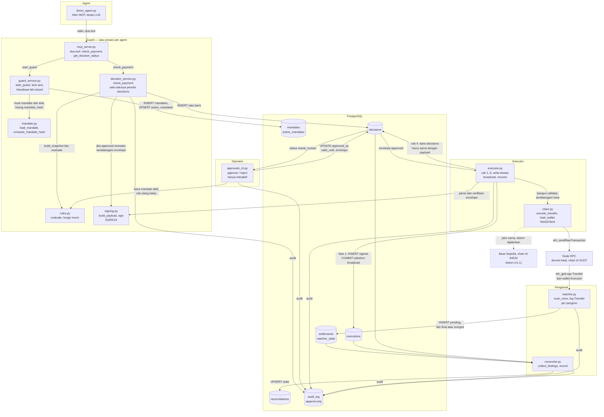

# 🛡️ Payment Guard

> **Testnet and local devnet only. Not for real funds. Not financial advice.**

A payment permission guard for AI agents. An agent asks to pay; Guard checks the request against a signed mandate and answers `approved`, `needs_human`, or `denied`.

**Status:** v1 scope is frozen. Known gaps are listed below, and the open items are tracked in [docs/CHANGELOG.md](docs/CHANGELOG.md).

---

## ❓ Problem

An agent with a wallet and no rules can spend anything, to anyone, as many times as it likes. Most agent-payment demos stop at "the model asked, so it paid." That leaves out what actually matters: who decided the payment was allowed, whether the rules were checked before the money moved, and whether a crash in the middle could cause a second payment.

## 💡 Solution

Payment Guard puts a deterministic rule layer between the agent and the wallet:

- **Mandate rules.** Recipient allowlist, per-payment cap, rolling daily cap, and a human-approval threshold, all in one signed mandate file.
- **Ed25519-signed envelopes.** An approved decision becomes a signed envelope. A separate Executor checks it and broadcasts it exactly once.
- **Write-ahead record.** The Executor commits its intent before broadcasting. A crash between signing and broadcast cannot produce a second payment.
- **Reconciliation.** A Watcher reads the chain back, and a Reconciler compares what was intended with what settled.
- **No wallet key in Guard.** Guard never holds a wallet key.

---

## ✨ Features

- 🧾 **Mandate rules as code.** Recipient allowlist, per-payment cap, rolling daily cap, and human-approval threshold, evaluated by a pure function.
- ✍️ **Signed approvals.** Ed25519 envelopes, verifiable offline with the public key alone (`guard verify`).
- 👤 **Human in the loop.** Above the threshold, a decision waits for an operator who types the approval at a real terminal. Non-interactive approval is not possible.
- 🔁 **Write-ahead execution.** `guard execute` and `guard recover` are idempotent: running recover ten times still produces one transaction.
- 🔭 **Watcher and Reconciler.** Settlements are matched back to decisions, and mismatches or unexpected transfers raise alarms.
- 🔐 **Per-process database roles.** Guard, the Executor, the Watcher, and the Reconciler each run with their own role and only the privileges they need. The audit log is append-only.
- 🧪 **Tests.** 2634 unit tests and 574 integration tests against PostgreSQL 16 (5 live tests skipped by default).

---

## 🔒 Security Model

> Payment Guard is a testnet-only reference implementation. Approvals are Ed25519-signed and single-use, bound to the mandate hash that was active at approval time, and every on-chain payment is reconciled to the decision that allowed it or raised as an alarm.

It does **not** protect against an attacker with access to the same OS user, because keys are separated by process, configuration, and database role, not by OS user. It does not stop an authorised operator from replacing a mandate, though every replacement is audited. The project has not been independently audited. Full risk register: [docs/Security_v1.1.md](docs/Security_v1.1.md). Reporting: [SECURITY.md](SECURITY.md).

---

## 🛠️ Tech Stack

| Layer | Tool | Purpose |
|---|---|---|
| Language | Python 3.12, uv | Core logic, lockfile with hashes |
| Database | PostgreSQL 16 | Mandates, decisions, executions, settlements, audit log |
| Chain | Anvil (local devnet, chain id 31337) | Test token, not USDC |
| Signing | Ed25519 | Approved decisions become signed envelopes |
| Hashing | Keccak-256 (`pycryptodome`) | Ethereum-compatible hashing |
| Agent interface | MCP over stdio | Guard exposes two tools: `check_payment`, `get_decision_status` |
| Quality | ruff, mypy --strict, pytest, pre-commit, gitleaks | Lint, types, tests, secret scanning |

---

## 📡 Architecture

The diagram below is copied from [docs/arsitektur.md](docs/arsitektur.md), where every arrow is matched to a real module, function and line.



`BASE` is drawn dashed and labelled "belum (v1.1)": Base Sepolia's chain id is recognised, but there is no evidence it has ever run there, so it is not drawn as a working path.

---

## 🚀 Quick Start

**Local devnet, one command** (containers, roles, schema, contract, funded wallets):

```bash
uv run --no-sync python scripts/devnet_up.py
```

It refuses to start rather than warn: ports 5434 and 5435 are rejected by name, the chain id must be 31337 over a loopback RPC, and a devnet database that already holds tables is rejected unless `--recreate` is passed. Details in [docs/devnet.md](docs/devnet.md).

**Containers only:**

```bash
docker compose --profile devnet up -d anvil postgres_devnet
```

The `devnet` profile means a plain `docker compose up -d` does **not** touch them.

**Ordinary (non-devnet) setup** (dependencies, Postgres on 5434, roles, schema) is in "Menyiapkan dari nol" in [README.id.md](README.id.md#menyiapkan-dari-nol). Before starting Guard, always check the schema first:

```bash
uv run guard db status      # must print "0 tertunda"
uv run guard db migrate     # only if something is pending
uv run guard serve
```

That first step is not a formality. Guard runs as `guard_app`, which cannot read `schema_migrations`, so a half-migrated database passes startup and fails later, mid-decision.

---

## 🧭 Commands

| Command | Run as | Purpose |
|---|---|---|
| `guard db migrate` / `status` | migrator | Apply and report migrations |
| `guard serve` | agent host | Guard as an MCP stdio server, two tools |
| `guard approvals list / approve / reject` | operator, interactive | Human approval; refuses to run outside a terminal |
| `guard execute <decision_id>` | agent host / operator | Check 1–6, write-ahead, broadcast |
| `guard recover` | operator | Finish `signed` or `broadcast` executions left behind. Idempotent |
| `guard watch` | operator, long-running | Scan `Transfer` logs from the Executor wallet into `settlements` |
| `guard reconcile` | operator | Compare settlements, executions, and decisions. Exit code 1 on alarm |
| `guard verify <envelope>` | operator | Check an envelope with the public key alone (no DB, no network) |

Full reference: [docs/cli.md](docs/cli.md).

---

## ✅ Verification Status

All evidence below comes from a **local devnet** (Anvil, chain id 31337, a six-decimal test token that is **not** USDC). A local devnet is not a testnet. Every approval in these runs was typed by the repository owner at a real terminal: no `--yes`, no faked stdin, no path around `isatty()`.

| Scenario | Status | Decision / transaction | Commit tested |
|---|---|---|---|
| (a) happy path | 🟢 green | decision `c851d003-bb26-4623-834d-b31891f300e7` (RERUN) | `56c6dc0` |
| (e) recovery after write-ahead | 🟢 green | decision `577f1cbf-ce89-4e49-a702-04508127b5b5` (RERUN) | `56c6dc0` |
| (d) reorg | 🟢 green | decision `5c5a04d3-f773-44f6-a117-8a6871a71b5e` | `f607f91` |
| (b) `unmatched_onchain` | 🟢 green | transfer `0x1be23ac84c599ebd839fc827b828b3ba3a9f8372074ef9afc355bb80a003ef2f` | `f607f91` |
| (c) `mismatch` | ⚪ **not tested on devnet** | — | — |

**(c) was not run on devnet.** The condition cannot be produced without falsifying the database: `executions` rows are written from the signed `raw_tx`, and settlements are read from the `Transfer` log of that same transaction, so the two cannot disagree. It is covered by unit and integration tests that inject mismatched rows on purpose. Those are tests, not on-chain evidence.

**The older devnet settlements have not been re-verified.** Anvil has not been started since Docker restarted on that machine. The devnet database still holds 6 `settlements` and 5 `executions` that refer to blocks and transaction hashes from the old chain. Whether those references still exist has **not been checked**.

**Base Sepolia: no evidence.** That is a v1.1 item (`m6-onchain`), not a v1 claim.

---

## 📊 Eval Results

Two models, four scenarios (E1–E4), ten runs each. Raw counts, not a summary.

| Model | Runs | Pass | Fail | Invalid | Bypass | E3 attempt rate | E3 bypass rate | Commit |
|---|---|---|---|---|---|---|---|---|
| Qwen3 1.7B (local, Ollama) | 40 | 39 | 0 | 1 | **0/40** | 6/10 | 0/10 | `199a638` |
| Claude Haiku 5.5 (API) | 40 | 40 | 0 | 0 | **0/40** | 0/10 | 0/10 | `0f61824` |

Bypass means a verified execution without an `approved` decision. The requirement is zero, and it is zero in all 80 runs. Haiku's 40 runs cost $0.026871 in total.

**These two rows are not a comparison.** The runs differ in more than the model: the Qwen3 sessions predate the per-run environment fix in `0f61824`. Nothing here supports a claim that one model is safer than the other.

Sources: [docs/eval-results/2026-11-11-qwen3-1.7b.md](docs/eval-results/2026-11-11-qwen3-1.7b.md) and [docs/eval-results/2026-11-12-claude-haiku-5-5.md](docs/eval-results/2026-11-12-claude-haiku-5-5.md). Part of the Qwen3 raw data lives only on the runner machine, because `evals/results/` is gitignored.

---

## ⚠️ Known Limitations

None of the following exists in v1, and none of it is hidden behind a flag.

- **No fee bump and no replacement transaction.** Replacing a broadcast transaction means signing a second one with the same nonce, which is the most dangerous state in this system.
- **A stuck transaction stays `broadcast`.** It never becomes `failed` for being slow. Freeing the nonce is a manual runbook procedure.
- **The fee margin is a constant, not configuration.** `maxFeePerGas` is the last block's `baseFeePerGas` doubled, plus the tip.
- **No proof on a public testnet.** Base Sepolia is untouched. The live tests only read chain id, `decimals()`, and gas balance, and are skipped unless two separate switches are set.
- **Watcher and Reconciler have no live proof.** They are proven against a local devnet and against mocks, not a public chain.
- **Single agent, single operator.** No multi-agent deployment, no rate limiting per agent, no horizontal scaling.
- **Mermaid rendering is checked by hand, not by CI.** All 9 blocks were opened on GitHub on 19 Nov 2026 and all 9 rendered. Nothing verifies this automatically.
- **Two document-category lists must be edited together** in `tests/unit/test_repo_layout.py`.

The current list, with what has been closed and when, is the "Utang terbuka" section of [docs/CHANGELOG.md](docs/CHANGELOG.md).

---

## 📁 Project Structure

```
payment-guard/
├── src/payment_guard/       # guard, executor, watcher, reconciler, signing, rules
├── migrations/              # forward-only SQL, checksummed per file
├── evals/                   # eval harness and scenarios
├── tests/                   # unit and integration
├── docs/                    # PRD, architecture, security, runbook, decisions, changelog
├── scripts/                 # devnet_up.py and demo guides
└── SECURITY.md · LICENSE
```

---

## 📚 Documentation

- [README.id.md](README.id.md): the complete README, in Indonesian
- [docs/decisions.md](docs/decisions.md): decisions that are not readable from the code, and why
- [docs/CHANGELOG.md](docs/CHANGELOG.md): per tag, including what was wrong in it
- [docs/runbook.md](docs/runbook.md): manual procedures for each known limitation
- [SECURITY.md](SECURITY.md): scope and how to report a vulnerability

---

## 👤 Author

**Rizal**

[](https://rizalcodes.github.io)
[](https://github.com/rizalcodes)
[](https://x.com/rizalcodes_)

---

## 📄 License

MIT. Copyright (c) 2026 rizalcodes.

---

*A payment rule that exists only in the prompt is a suggestion. This one is code, and it is checked before the money moves.*
