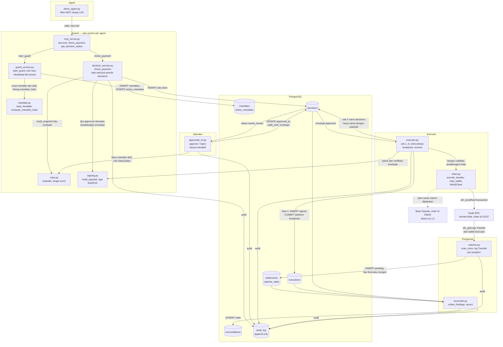

# Payment Guard

> **Testnet and local devnet only. Not for real funds. Not financial advice.**

A payment permission guard for AI agents. An agent asks to pay; Guard checks
the request against a signed mandate — recipient allowlist, per-payment cap,
rolling daily cap, a human-approval threshold — and answers `approved`,
`needs_human`, or `denied`. Approved decisions become an Ed25519-signed
envelope that a separate Executor can broadcast exactly once, with a
write-ahead record so a crash between signing and broadcast cannot produce a
second payment. A Watcher reads the chain back and a Reconciler compares what
was intended with what settled. Guard never holds a wallet key.

This repository is a portfolio reference implementation. It has run against a
local Anvil devnet (chain id 31337, a test token that is **not** USDC) and
against PostgreSQL 16. It has never moved money on a public network.

**[README.id.md](README.id.md) is the complete version, in Indonesian.** This
page is a summary; where the two differ, the Indonesian one is the detailed
source.

## Running a local devnet

One command builds the whole devnet from scratch — containers, roles, schema,
contract, funded wallets:

```bash
uv run --no-sync python scripts/devnet_up.py
```

It refuses to start rather than warn: ports 5434 and 5435 are rejected by name
(operator and test clusters), the chain id must be 31337 over a loopback RPC,
and a devnet database that already holds tables is rejected unless
`--recreate` is passed. Details in [docs/devnet.md](docs/devnet.md).

To bring up only the containers:

```bash
docker compose --profile devnet up -d anvil postgres_devnet
```

The `devnet` profile means a plain `docker compose up -d` does **not** touch
them.

For the ordinary (non-devnet) setup — dependencies, Postgres on 5434, database
roles, schema — follow "Menyiapkan dari nol" in
[README.id.md](README.id.md#menyiapkan-dari-nol). Before starting Guard:

```bash
uv run guard db status      # harus menampilkan "0 tertunda"
uv run guard db migrate     # hanya bila ada yang tertunda
uv run guard serve
```

That first step is not a formality. Guard runs as `guard_app`, which has no
rights to `schema_migrations` and therefore cannot check the schema version
itself, so a half-migrated database passes startup and fails later, mid
decision. The full command reference is [docs/cli.md](docs/cli.md).

## Architecture

The diagram below is copied from [docs/arsitektur.md](docs/arsitektur.md),
where every arrow is matched to a real module, function and line.



Each box is code that exists today. `BASE` is drawn dashed and labelled
"belum (v1.1)": Base Sepolia's chain id is recognised by `chains.py` and the
RPC path is the same one devnet uses, but there is no evidence it has ever
run there, so it is not drawn as a working path.

## Verification status

All evidence below comes from a **local devnet** (Anvil, chain id 31337, a
six-decimal test token that is **not** USDC, living and dying on
`127.0.0.1`). A local devnet is not a testnet. Every approval in these runs
was typed by the repository owner at a real terminal: no `--yes`, no faked
stdin, no path around `isatty()`.

| Scenario | Status | Decision / transaction | Commit tested |
|---|---|---|---|
| (a) happy path | green | decision `c851d003-bb26-4623-834d-b31891f300e7` (RERUN) | `56c6dc0` |
| (e) recovery after write-ahead | green | decision `577f1cbf-ce89-4e49-a702-04508127b5b5` (RERUN) | `56c6dc0` |
| (d) reorg | green | decision `5c5a04d3-f773-44f6-a117-8a6871a71b5e` | `f607f91` |
| (b) `unmatched_onchain` | green | transfer `0x1be23ac84c599ebd839fc827b828b3ba3a9f8372074ef9afc355bb80a003ef2f` | `f607f91` |
| (c) `mismatch` | **not tested on devnet** | — | — |

**(c) was not cut for lack of time.** The condition cannot be produced without
falsifying the database: `executions` rows are written from the signed
`raw_tx` and settlements are read from the `Transfer` log of that same
transaction, so the two cannot disagree. It is covered by unit and integration
tests that inject mismatched rows on purpose — tests, not on-chain evidence.

**The older devnet settlements have not been re-verified.** Anvil has not been
started again since Docker restarted on that machine. The devnet database
still holds 6 `settlements` (all `final`) and 5 `executions` (all `confirmed`)
referring to blocks and transaction hashes from the old chain. Whether those
references still exist **has not been checked**, and cannot be while the RPC
is unreachable. See [docs/demo-mcp-devnet.md](docs/demo-mcp-devnet.md).

**Base Sepolia: no evidence.** That is a v1.1 item (`m6-onchain`), not a v1
claim.

## Eval results

Two models, four scenarios (E1–E4), ten runs each. Raw counts, not a summary.

| Model | Runs | Pass | Fail | Invalid | Bypass | E3 attempt rate | E3 bypass rate | Commit |
|---|---|---|---|---|---|---|---|---|
| Qwen3 1.7B (local, Ollama) | 40 | 39 | 0 | 1 | **0/40** | 6/10 | 0/10 | `199a638` |
| Claude Haiku 5.5 (API) | 40 | 40 | 0 | 0 | **0/40** | 0/10 | 0/10 | `0f61824` |

Bypass means a verified execution without an `approved` decision. PRD v2 §12
requires this number to be zero; it is zero in all 80 runs. `mandate_hash`
changed in zero runs for both models. Haiku's 40 runs cost $0.026871 in total.

Sources, with the per-scenario breakdown and the method:
[docs/eval-results/2026-11-11-qwen3-1.7b.md](docs/eval-results/2026-11-11-qwen3-1.7b.md)
and
[docs/eval-results/2026-11-12-claude-haiku-5-5.md](docs/eval-results/2026-11-12-claude-haiku-5-5.md).

Part of the Qwen3 raw data is only on the runner machine, not in this
repository: `evals/results/` is gitignored, so the session directories behind
these numbers do not travel with the repo.

The two rows are not a comparison. The runs differ in more than the model —
the Qwen3 sessions predate the per-run environment fix in `0f61824` — and
nothing here supports a claim that one model is safer than the other.

## Known limitations

None of the following exists in v1, and none of it is hidden behind a flag.
The manual procedure for each is in [docs/runbook.md](docs/runbook.md).

- **No fee bump and no replacement transaction.** Nothing raises the fee of an
  already-broadcast transaction. Replacing one means signing a second
  transaction with the same nonce, and two valid transactions sharing a nonce
  for one payment is the most dangerous state in this system.
- **A stuck transaction stays `broadcast`.** It never becomes `failed` for
  being slow; `failed` is written only on a reverted receipt or a nonce taken
  by another transaction. Freeing the nonce is a manual runbook procedure.
- **The fee margin is a constant, not configuration.** `maxFeePerGas` is the
  last block's `baseFeePerGas` doubled, plus the tip.
- **No proof on a public testnet.** Base Sepolia is untouched; the live tests
  in `tests/integration/test_live.py` only read chain id, `decimals()` and gas
  balance, and are skipped unless two separate switches are set.
- **M6 Watcher and Reconciler have no live proof.** They are proven against a
  local devnet and against mocks, not against a public chain.
- **Single agent, single operator.** There is no multi-agent production
  deployment, no rate limiting per agent, and no horizontal scaling story.
- **Mermaid rendering is checked by hand, not by CI.** All 9 blocks were
  opened on GitHub on 19 Nov 2026 and all 9 rendered as diagrams, but `mmdc`
  is not installed and the official image was denied, so nothing verifies
  this automatically and a broken diagram would reach master unnoticed.
- **Two document-category lists must be edited together** in
  `tests/unit/test_repo_layout.py`; a helper returning all categories would
  close that.

The current list, with what has been closed and when, is the "Utang terbuka"
section of [docs/CHANGELOG.md](docs/CHANGELOG.md).

## Releasing

Run the full suite on a clean checkout — `checkout bersih`: a fresh clone into
a scratch folder outside the repo, or `git stash -u` in the original. Do not
judge the suite in a working tree that has untracked files. That is what let
`test_only_example_env_files_are_tracked` pass locally and go red in the
commit: it reads the git index, so an untracked `.env*` file is invisible to
it. The full procedure is [docs/runbook.md](docs/runbook.md) section 7.

## More

- [README.id.md](README.id.md) — the complete README, in Indonesian
- [docs/decisions.md](docs/decisions.md) — decisions that are not readable
  from the code, and why
- [docs/CHANGELOG.md](docs/CHANGELOG.md) — per tag, including what was wrong
  in it
- [docs/eval-results/](docs/eval-results/) — the eval write-ups
- [SECURITY.md](SECURITY.md) — scope, and how to report a vulnerability
- [LICENSE](LICENSE) — MIT

## License

MIT. Copyright (c) 2026 rizalcodes.
