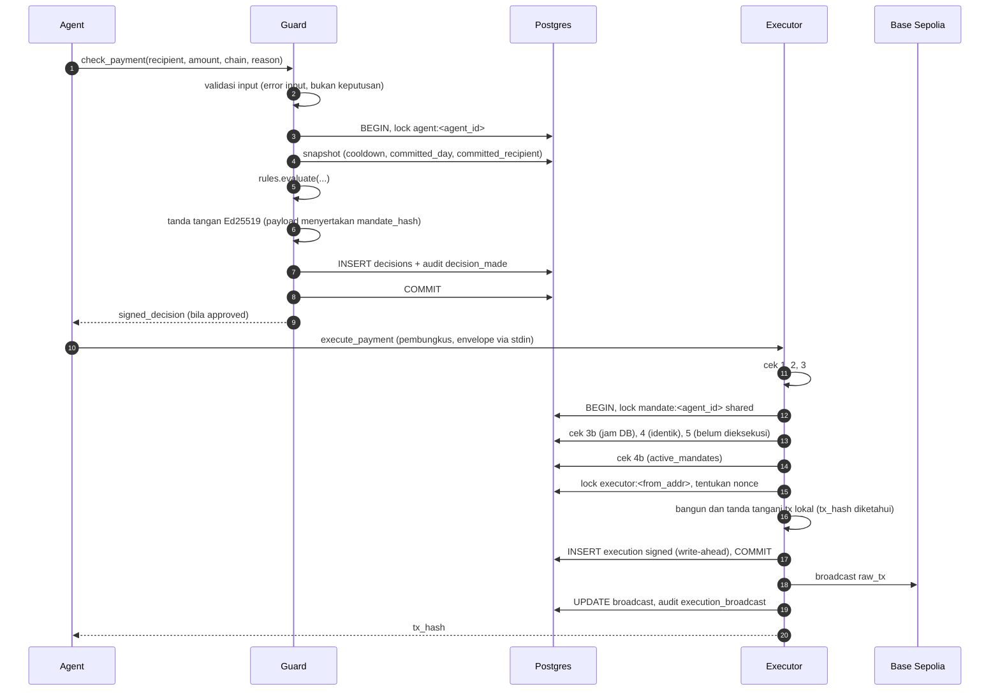
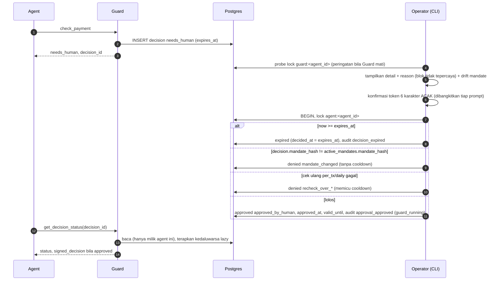
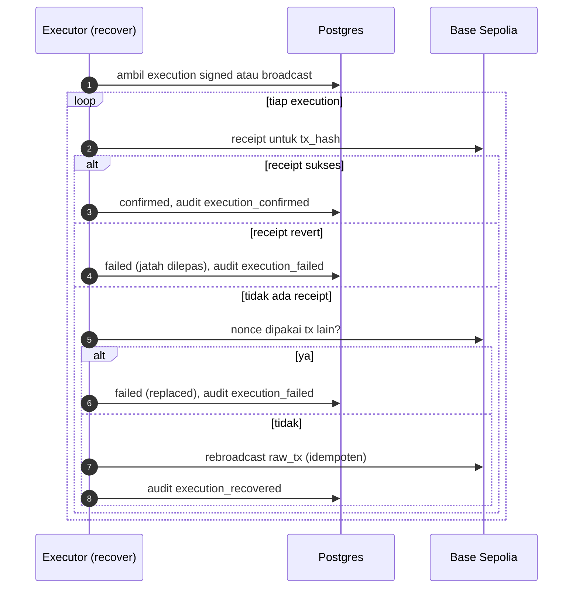
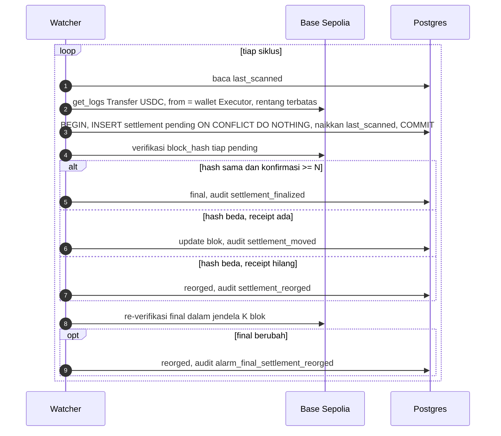
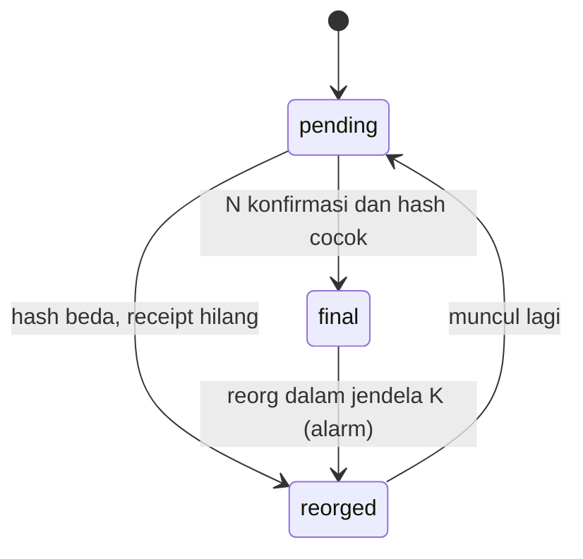
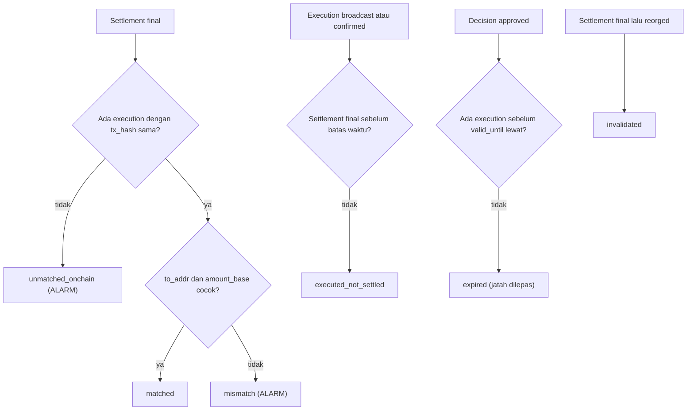
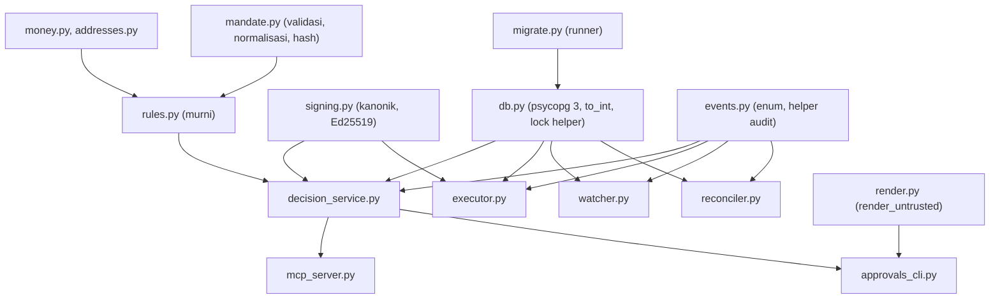

# Payment Guard — Arsitektur v1.1

> Pendamping PRD v2.1 dan Security v1.1. Sumber kebenaran skema: `0001_init.sql` dan `0002_roles.sql`.
> Status: reference implementation, testnet only. Penulis: Chief of Strategy, 30 Okt 2026.

---

## 1. Prinsip desain

1. **Gagal tertutup.** Guard, DB, atau RPC mati → tidak ada uang bergerak.
2. **Satu sumber kebenaran per hal.** Keputusan = `decisions`. Chain = `settlements`. Penghubung = `executions`. Sejarah = `audit_log`. Mandate yang berlaku = `active_mandates`.
3. **Aturan adalah fungsi murni.** `rules.evaluate()` tidak menyentuh DB, jaringan, atau jam.
4. **Jangan percaya data masuk.** Agent, RPC, dan payload envelope diperlakukan sebagai tidak tepercaya dan dicocokkan ulang.
5. **Semua penilaian waktu memakai jam database.**
6. **Idempoten di setiap tepi.** Watcher, recovery, migrasi, dan bootstrap aman diulang.
7. **Hak minimum per proses.** Setiap proses punya role database sendiri.
8. **Jujur soal batas.** Setiap batas ditulis di Security v1.1.

---

## 2. Proses, batas kepercayaan, dan konfigurasi

| Proses | Dijalankan sebagai | Memegang | Tidak boleh memegang |
|---|---|---|---|
| **Guard** | `guard serve --mandate …` (stdio, satu per agent) | Key tanda tangan (baca), mandate path, `GUARD_DB_URL` | Key wallet, `RPC_URL` |
| **Pembungkus `execute_payment`** | Fungsi di host agent | — | Semua key, `RPC_URL`, `*_DB_URL` (env host dibersihkan) |
| **Executor** | `guard execute` (subproses) | Key wallet, public key Guard, `RPC_URL`, `EXECUTOR_DB_URL` | Key tanda tangan |
| **Approvals CLI** | `guard approvals …` (operator, interaktif) | Key tanda tangan (baca), `APPROVER_DB_URL` | Key wallet, `RPC_URL` |
| **Watcher** | `guard watch` (proses panjang) | `RPC_URL`, `WATCHER_DB_URL` | Kedua key |
| **Reconciler** | `guard reconcile` | `RECONCILER_DB_URL` | Kedua key, `RPC_URL` |
| **Migrator** | `guard db migrate` / `status` | `MIGRATOR_DB_URL` (dari `.env.migrator`) | Dipakai proses runtime mana pun; URL-nya tidak ada di `.env` |
| **Bootstrap** | `guard db bootstrap-roles` (admin, sekali) | URL admin dari env sementara, tidak disimpan | Dipakai runtime mana pun |
| **Eval runner** | `python -m evals.run` | `EVAL_API_KEY` (opsional) | Semua key lain |

**Batas jujur:** pemisahan ini adalah pemisahan proses, konfigurasi, dan hak database. Bukan pemisahan user OS. Lihat Security v1.1 (RR-1).

### 2.1 Variabel konfigurasi

| Variabel | Dibaca oleh | Rahasia |
|---|---|---|
| `GUARD_DB_URL` | Guard | ya |
| `APPROVER_DB_URL` | Approvals CLI | ya |
| `EXECUTOR_DB_URL` | Executor | ya |
| `WATCHER_DB_URL` | Watcher | ya |
| `RECONCILER_DB_URL` | Reconciler | ya |
| `MIGRATOR_DB_URL` | Migrator | ya (di `.env.migrator`, bukan `.env`) |
| `GUARD_MANDATE_PATH` | Guard | tidak |
| `GUARD_SIGNING_KEY_PATH` | Guard, Approvals CLI | **ya** |
| `GUARD_PUBLIC_KEYS_PATH` (`guard_public.json`) | Executor, `guard verify` | tidak (boleh di-commit) |
| `RPC_URL` | Executor, Watcher | **ya** (API key di URL) |
| `EXECUTOR_KEY_PATH` | Executor | **ya** |
| `CHAIN_ID` (84532), `USDC_ADDRESS` | Executor, Watcher | tidak (diverifikasi) |
| `CONFIRMATIONS` (12), `SCAN_BATCH_SIZE`, `REORG_LOOKBACK` (64) | Watcher | tidak |
| `EVAL_API_KEY` | Eval runner | **ya** |

Admin URL untuk bootstrap **tidak** ada di file `.env` mana pun. Diberikan lewat env sementara saat perintah dijalankan, atau prompt tersembunyi. Sejak M0.1, bootstrap juga **menolak URL admin yang hostnya bukan loopback** kecuali diberi `--allow-remote-admin`.

Semua rahasia: file env atau file izin 600, di-gitignore, di-redaksi di log, dipindai gitleaks. Konfigurasi divalidasi saat start, gagal bila tidak valid.

### 2.2 Dua file env (M0.1)

| File | Isi | Ditulis oleh | Dibaca oleh |
|---|---|---|---|
| `.env` | Lima URL runtime (`GUARD_`, `APPROVER_`, `EXECUTOR_`, `WATCHER_`, `RECONCILER_`) dan konfigurasi non-DB | `bootstrap-roles` | Proses runtime masing-masing |
| `.env.migrator` | Hanya `MIGRATOR_DB_URL` | `bootstrap-roles` | `guard db migrate`, `guard db status` |

Pemuat konfigurasi runtime (`config.load_runtime_config`) tidak pernah membuka `.env.migrator`, dan objek `RuntimeConfig` tidak punya atribut untuk URL migrator. `guard db migrate` dan `guard db status` tidak pernah membuka `.env`. Keduanya ditegakkan tes.

Alasannya: role migrator adalah pemilik semua objek dan karena itu bisa melepas trigger append-only (Security v1.1 RR-2). Memisahkan filenya memastikan URL itu tidak ikut termuat ke proses runtime, tidak ikut ter-log, dan tidak terbawa dump environment runtime.

**Override environment untuk CI (opsi A).** `MIGRATOR_DB_URL` dari environment tetap diterima `guard db migrate` dan `guard db status`, dan itu memang disengaja: CI perlu menyuntikkan URL tanpa menulis rahasia ke disk. Override ini hanya berlaku untuk variabel migrator itu sendiri. Ia **tidak pernah** boleh menggantikan `.env` runtime maupun menyebabkan `.env` dimuat: kedua perintah itu tidak membuka `.env` dalam keadaan apa pun, termasuk ketika environment `MIGRATOR_DB_URL` kosong. Ada tes penjaga regresi untuk sifat itu. Perlu dicatat juga bahwa environment proses **bisa dibaca proses mana pun di user yang sama**, jadi override ini tidak lebih aman daripada file — batasnya sama dengan RR-1; yang berbeda hanya tempat rahasianya mendarat.

**Batas yang jujur.** Ini **bukan** batas keamanan keras. Di Windows izin file tidak setara `chmod 600`, dan di OS mana pun **semua proses milik user yang sama bisa membaca kedua file** (dan environment-nya). Yang dicegah pemisahan ini adalah pemuatan dan kebocoran yang tidak disengaja, bukan penyerang yang sudah memegang user itu. Masuk Security v1.1 RR-1.

Contoh tanpa nilai: `.env.example` dan `.env.migrator.example`. Keduanya boleh di-commit; `.env` dan `.env.migrator` di-gitignore (pola `.env.*` dengan negasi untuk kedua contoh).

---

## 3. Role database

### 3.1 Role
- **Role grup** (NOLOGIN, tanpa password): `guard_rw`, `approver_rw`, `executor_rw`, `watcher_rw`, `reconciler_rw`. Dibuat oleh `guard db bootstrap-roles` dengan blok `DO` idempoten.
- **Role login** per proses (`guard_app`, `approver_app`, `executor_app`, `watcher_app`, `reconciler_app`): password acak, dibuat bootstrap, disimpan di `.env` (gitignored), anggota role grup masing-masing.
- **Owner** = role migrator (`migrator_owner`), bukan superuser. Pemilik semua objek.

### 3.2 Pembagian tugas
- `bootstrap-roles` (admin): membuat role grup, role login, `REVOKE ALL ON SCHEMA public FROM PUBLIC`, `GRANT USAGE ON SCHEMA`.
- `0002_roles.sql` (migrator): hanya hak tabel dan sequence. Memastikan role grup ada; bila belum, `RAISE EXCEPTION 'jalankan guard db bootstrap-roles dulu'`.
- Runner migrasi memasang notice handler dan menggagalkan migrasi bila ada `WARNING` berpola "no privileges".

**Guard tidak bisa memverifikasi versi migrasi (keputusan M3, opsi A).**
`guard_app` tidak punya hak apa pun ke `schema_migrations` (lihat matriks di
3.3), dan hak itu **tidak** ditambahkan: tabel itu milik owner saja. Akibatnya
`require_tables` saat start hanya memastikan tabel yang dibutuhkan **ada**,
bukan bahwa skemanya versi terakhir.

- **Operator wajib** menjalankan `guard db status` (role migrator) dan
  memastikan **tidak ada migrasi yang tertunda** sebelum `guard serve`.
- Database yang dimigrasi setengah jalan **lolos** start Guard. Ini batas yang
  diterima, bukan bug: menutupnya butuh hak baru atau tabel baru, dan keduanya
  lebih mahal daripada satu langkah operator.
- Opsi B — tabel atau view versi khusus yang boleh dibaca `guard_app`, lewat
  migrasi `0003` — **ditinjau di M9**, bersama perubahan CHECK nama event di
  `audit_log`, supaya dua perubahan skema jadi satu.

Tercatat sebagai RR-12 di Security v1.1 bagian 10. Langkah operatornya ada di
README, bagian "Menjalankan Guard".

### 3.3 Matriks hak minimum

| Tabel | guard | approver | executor | watcher | reconciler |
|---|---|---|---|---|---|
| decisions | S, I, U* | S, U* | S | — | S |
| mandates | S, I | S | S | — | S |
| active_mandates | S, I, U | S | S | — | — |
| executions | S | S | S, I, U* | — | S |
| settlements | — | — | — | S, I, U* | S |
| reconciliations | — | — | — | — | S, I, U* |
| watcher_state | — | — | — | S, I, U | — |
| audit_log | S, I | S, I | I | I | S, I |
| schema_migrations | — | — | — | — | — (hanya owner) |

\* = UPDATE per kolom sesuai transisi. Contoh: executor hanya `status`, `broadcast_at`, `updated_at`. Guard hanya kolom yang diperlukan untuk kedaluwarsa lazy.

**Sequence (USAGE saja):**
- `audit_log_id_seq`: guard, approver, executor, watcher, reconciler
- `executions_id_seq`: executor
- `settlements_id_seq`: watcher
- `reconciliations_id_seq`: reconciler

**Tidak ada role yang punya DELETE, TRUNCATE, atau DDL.**

Catatan: FK membutuhkan SELECT pada tabel induk. Matriks sudah memenuhinya.

### 3.4 Tes hak akses
Tes memeriksa dua arah: objek di DB tanpa baris matriks → gagal; baris matriks tanpa objek → gagal. Hak efektif diperiksa dengan `has_table_privilege`, `has_column_privilege`, `has_sequence_privilege`. Tidak ada grant ke `PUBLIC` pada objek aplikasi. Dijalankan setelah semua migrasi.

---

## 4. Lock: satu tabel, satu aturan

| Namespace | Kunci | Jenis | Diambil oleh | Tujuan |
|---|---|---|---|---|
| `guard` | `guard:<agent_id>` | sesi, koneksi dedikasi | Guard (selama hidup) | Satu Guard per agent |
| `agent` | `agent:<agent_id>` | transaksi, eksklusif | Guard `check_payment`, Approvals approve/reject | Serialisasi jatah dan approve |
| `mandate` | `mandate:<agent_id>` | transaksi; eksklusif (Guard start), shared (Executor) | Guard start (eksklusif), Executor write-ahead (shared) | Serialisasi pergantian mandate vs execution baru |
| `executor` | `executor:<from_addr>` | transaksi, eksklusif | Executor | Satu penulis nonce |
| `watcher` | `watcher:<chain_id>` | sesi | Watcher | Satu Watcher per chain |
| `migrate` | `migrate` | transaksi | Runner migrasi | Satu runner |

**Kunci dihitung di aplikasi:** `sha256("<namespace>:<identitas>")`, ambil 8 byte pertama, big-endian, signed int64. Namespace konstanta. Panggil varian bigint (`pg_advisory_xact_lock`, `..._shared`, dan varian sesi). Tes known-answer dan namespace berbeda → kunci berbeda.

**Aturan urutan lock (mencegah deadlock):**
1. Dalam satu transaksi, ambil lock `mandate:` sebelum tabel lain.
2. Lock `agent:` diambil sebelum baca `active_mandates` di jalur Guard.
3. Lock `executor:` diambil sebelum INSERT `executions`.

Jalur Executor write-ahead: `mandate:` (shared) → baca `active_mandates` → cek 4b → `executor:` → INSERT `executions`.
Jalur Guard start: `mandate:` (eksklusif) → UPSERT `mandates` → UPSERT `active_mandates` → audit `mandate_loaded`.
Jalur Guard `check_payment`: `agent:` → baca snapshot → INSERT `decisions` → audit `decision_made`.

Tes paralel: pergantian mandate versus pembuatan execution, kedua urutan diuji. Hasilnya selalu konsisten.

**Lock sesi Guard:**
- Koneksi dedikasi langsung ke Postgres. Tidak lewat pgbouncer mode transaksi atau pool.
- Heartbeat `SELECT 1` tiap 5 detik, timeout 2 detik.
- Heartbeat gagal atau koneksi putus → Guard berhenti menjawab, audit `guard_lock_lost` (bila memungkinkan), keluar.

**Probe Approvals CLI:** `pg_try_advisory_lock(guard:<agent_id>)` pada koneksi sendiri. Bila berhasil, langsung `pg_advisory_unlock` pada koneksi yang sama. Bila gagal, Guard hidup.

**Lock timeout:** `lock_timeout` dan `statement_timeout` di transaksi Guard dan Executor.

---

## 5. Mandate: normalisasi, hash, dan mandate aktif

### 5.1 Hash
- `mandate_hash` = SHA-256 dari awalan `payment-guard/mandate/v1\n` + JSON kanonik ternormalisasi.
- Normalisasi: angka uang dalam base units, alamat lowercase, allowlist diurutkan, kunci diurutkan, tanpa spasi, UTF-8.
- Fungsi kanonik sama dengan signing.

### 5.2 Tabel
```sql
-- mandates (append-only): mandate_hash PK, mandate_id, agent_id, content JSONB, first_seen_at
-- active_mandates: agent_id PK, mandate_hash FK -> mandates, activated_at
```
`active_mandates` dibuat setelah `mandates` dan sebelum `decisions`.

### 5.3 Saat Guard start (satu transaksi)
1. Validasi mandate, normalisasi, hitung hash.
2. Ambil `pg_advisory_xact_lock(mandate:<agent_id>)` (eksklusif).
3. `INSERT ... ON CONFLICT DO NOTHING` ke `mandates`.
4. `INSERT ... ON CONFLICT (agent_id) DO UPDATE SET mandate_hash, activated_at` ke `active_mandates`.
5. Audit `mandate_loaded` `{mandate_id, mandate_hash}`.
6. Commit. Lalu ambil session lock `guard:<agent_id>` di koneksi dedikasi. Bila sudah dipegang, gagal dengan pesan jelas.

Urutan langkah 2 dan 6 penting: session lock diambil setelah transaksi commit, jadi Guard kedua gagal sebelum mengubah `active_mandates`.

Sebelum langkah 1, Guard memastikan tabel yang dibutuhkan ada. Yang **tidak** ia periksa adalah versi migrasinya; lihat 3.2 dan RR-12.

### 5.4 Mandate aktif tidak sama dengan file di disk
- Sumber kebenaran "mandate aktif" = `active_mandates` (apa yang Guard muat).
- File di disk berubah tanpa restart → tidak berpengaruh.
- Guard mati ≠ tidak ada mandate aktif. `active_mandates` tidak dihapus saat Guard mati.

---

## 6. Alur utama: permintaan disetujui



Poin penting:
- Lock per transaksi pendek. Ed25519 murah, aman di dalam lock.
- `UNIQUE(decision_id)` menegakkan sekali pakai. Cek 5 dibaca di transaksi yang sama.
- Transaksi Executor dibangun dari field payload.

---

## 7. Approve, reject, dan kedaluwarsa



- **Kedaluwarsa lazy:** oleh job atau akses pertama (approve, reject, get_decision_status, daftar approvals). `decided_at` memakai `expires_at`. Waktu deteksi nyata di audit.
- **Reject eksplisit** → `rejected_by_human (human_rejected)`, memicu cooldown.
- **Token konfirmasi** = 6 karakter **acak**, dibangkitkan ulang setiap kali prompt ditampilkan dan tidak pernah disimpan. Sumber acaknya CSPRNG (`secrets`). Alfabetnya Crockford base32 (`0123456789ABCDEFGHJKMNPQRSTVWXYZ`): tanpa `I`, `L`, `O`, dan `U`, dan masukan dibaca dengan aturan Crockford sehingga `O` dibaca `0` serta `I` dan `L` dibaca `1` — operator yang salah lihat tetap berhasil, bukan ditolak.

  > **Revisi, 4 November 2026.** Spesifikasi sebelumnya adalah "6 karakter terakhir `decision_id`". Itu diganti karena `decision_id` **dikembalikan ke agent** di respons `check_payment`, sehingga agent bisa menghitung sendiri token yang akan diminta ke operator lalu menyelipkannya ke `reason` sebagai bagian dari bujukan. Token acak menutup jalur itu seluruhnya.

  Yang tidak berubah: ini tetap pengaman **anti-refleks** terhadap operator yang menyetujui tanpa membaca, bukan kontrol keamanan terhadap agent. Agent yang bisa menjalankan perintah di mesin operator bisa membaca layarnya, dan token apa pun tidak menolong di sana (Security v1.1 asumsi 2, RR-1, RR-9).

---

## 8. Executor: write-ahead, cek, dan recovery

### 8.1 Cek (hanya untuk execution baru)
Urutan: 1, 2, 3, 3b, 4, 5, 4b. Alasan penolakan tertutup di `docs/events.md`: `signature_invalid`, `version_or_chain_mismatch`, `not_approved`, `expired`, `decision_mismatch`, `already_executed`, `mandate_not_active`.

Cek 5 sebelum 4b: upaya eksekusi ulang decision yang sudah dieksekusi selalu tercatat sebagai `already_executed`, meski mandate sudah berganti.

### 8.2 Recovery
Berjalan di awal `guard execute` dan lewat `guard executor recover`.



Recovery tidak memverifikasi ulang envelope, mandate, atau `valid_until`. Execution yang sudah dikomit tetap diselesaikan.

### 8.3 Nonce
Di bawah lock `executor:<from_addr>`: `max(nonce pending dari RPC, nonce tertinggi di DB + 1)`. `UNIQUE(from_addr, nonce)` sebagai jaring pengaman.

---

## 9. Guard: heartbeat dan fail-closed

- Heartbeat 5 detik, timeout 2 detik, pada koneksi lock.
- Gagal → Guard berhenti menjawab `check_payment` dan `get_decision_status`. Event `guard_lock_lost` (bila memungkinkan) lalu proses keluar.
- Guard kedua untuk agent sama tidak bisa start selama lock dipegang.

---

## 10. Watcher & reorg



Watcher memegang session lock `watcher:<chain_id>`. Dua Watcher tidak bisa jalan bersamaan.

Verifikasi `chain_id` RPC, `decimals()` USDC = 6, dan alamat token = `USDC_ADDRESS` terverifikasi (tiga sumber: dokumen Circle, explorer, `decimals()`). Ketidakcocokan → stop dan laporkan.

State machine:



---

## 11. Rekonsiliasi



Satu baris per subjek di `reconciliations` (upsert). Setiap perubahan state ditulis ke `audit_log` (`reconciliation_state_changed`).

---

## 12. Modul dan dependensi



Aturan:
- `rules.py`, `money.py`, `addresses.py`, `mandate.py` tidak mengimpor `db`, jaringan, atau jam.
- Hanya `events.py` menulis `audit_log`. Tidak ada string event di luar enum.
- `executor.py` tidak mengimpor key tanda tangan. `mcp_server.py` tidak mengimpor key wallet.
- `render_untrusted()` adalah satu-satunya jalur menampilkan teks dari agent.
- Tidak ada `float` di `src/`. Tidak ada SQL dirakit string.

---

## 13. Mode gagal

| Gagal | Dampak | Penanganan |
|---|---|---|
| Guard mati | Agent tidak bisa minta izin | Fail closed |
| DB mati | Tidak ada keputusan, eksekusi, atau catatan | Fail closed, tool mengembalikan error |
| Koneksi lock Guard putus | Lock lepas diam-diam | Heartbeat gagal → Guard berhenti |
| RPC mati saat broadcast | Execution di `signed` | Recovery rebroadcast |
| RPC mati untuk Watcher | Pemindaian berhenti | `last_scanned` tidak maju |
| RPC data janggal | Potensi catatan salah | Verifikasi hash dan `chain_id`, `rpc_error` |
| Executor crash | Tx mungkin sudah/belum terkirim | Write-ahead + recovery |
| Watcher crash di batch | Setengah batch | Satu transaksi, atomik |
| Mandate diedit tanpa restart | Tidak berpengaruh | Tidak ada hot-reload |
| Mandate berganti saat ada `needs_human` | Keputusan lama | Approve → `denied (mandate_changed)` |
| Mandate berganti setelah approve, sebelum execution | Execution baru ditolak | Cek 4b → `mandate_not_active` |
| Mandate berganti setelah execution `signed` | Transaksi sudah dikomit | Recovery tetap jalan (by design) |
| Selisih jam | Salah menilai kedaluwarsa | Jam DB |
| Role DB dibobol | Hanya tabel yang diizinkan | Matriks hak; pemilik di luar jaminan |
| Lock ditahan role dibobol | DoS | `lock_timeout` |
| Reorg lebih dalam dari N | Final berubah | Jendela K, alarm, `invalidated` |

---

## 14. Keputusan desain di dokumen ini
1. Executor sebagai subproses CLI, dipanggil lewat pembungkus lokal. Env host dibersihkan.
2. Recovery berjalan di awal `guard execute` dan juga lewat `guard executor recover`.
3. Session lock per agent di Guard, per chain di Watcher, di koneksi dedikasi.
4. Tidak ada idempotency key di `check_payment` (v1).
5. Mandate tidak di-reload panas.
6. Nonce: `max(nonce pending RPC, nonce DB + 1)` di bawah lock Executor.
7. Serialisasi 4b dan pergantian mandate lewat advisory lock `mandate:<agent_id>`, bukan `FOR SHARE`.
8. Matriks hak minimum, dengan role per proses dan role grup NOLOGIN.
