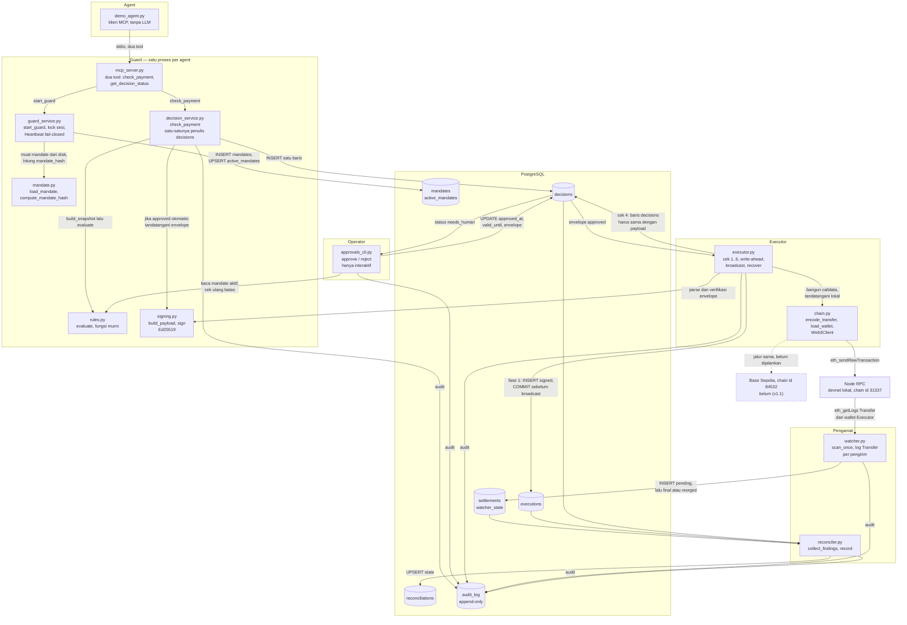
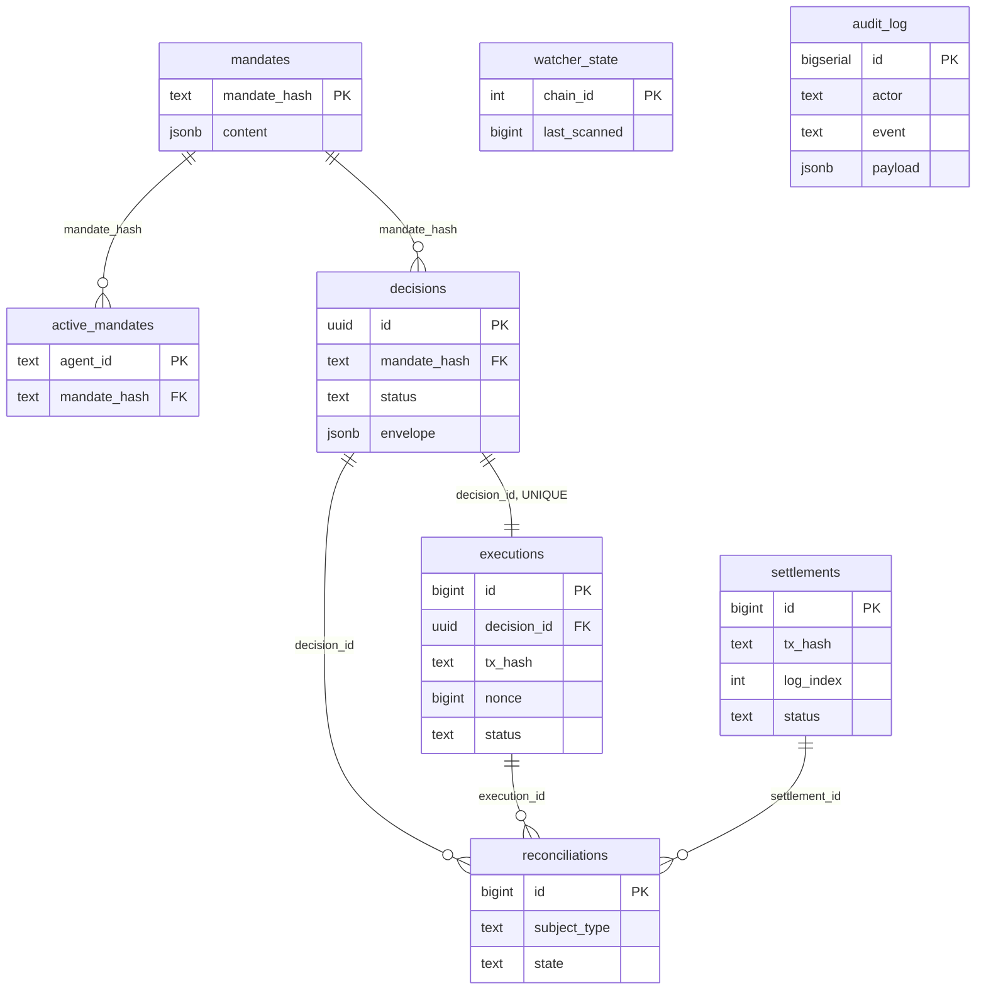

# Arsitektur

Diagram di bawah menggambarkan **kode yang ada di `src/payment_guard/` saat
dokumen ini ditulis**, bukan rencana. Setiap panah bisa ditunjuk ke modul dan
fungsi yang nyata, dan nomor barisnya disebut di tabel sesudah diagram —
nomor baris itu berlaku untuk commit tempat dokumen ini masuk, dan **nama
fungsinyalah yang mengikat**, bukan nomornya. Yang
**tidak** digambar sebagai alur yang berjalan: pembayaran di testnet publik
Base Sepolia. Chain id 84532 memang dikenali `chains.py`, dan jalur RPC-nya
sama persis dengan yang dipakai devnet, tapi tidak ada bukti bahwa ia pernah
dijalankan di sana — jadi ia muncul sebagai kotak bergaris putus-putus
berlabel "belum (v1.1)". Hal yang sama berlaku untuk hal-hal yang ada di
dokumen tapi belum ada kodenya: tidak digambar sama sekali.

Yang digambar hanyalah jalur pembayaran. Perintah administratif
(`guard db bootstrap-roles`, `guard db migrate`, `guard keygen`) punya
modulnya sendiri dan tidak lewat jalur ini, jadi mereka tidak ada di diagram.

## Alur pembayaran

### Setiap panah dan sumbernya

| Panah | Modul dan fungsi |
|---|---|
| Agent → MCP | `demo_agent.py`; `mcp_server.py` `TOOL_NAMES` baris 69, `serve` baris 156 |
| MCP → Guard session | `guard_service.py` `start_guard` baris 291; `Heartbeat` baris 384 |
| Guard → mandate | `guard_service.py` `load_mandate_file` baris 190 → `mandate.py` `load_mandate`, `compute_mandate_hash` |
| Guard → `mandates`, `active_mandates` | `guard_service.py` `start_guard`, satu transaksi dengan lock `mandate:<agent_id>` |
| MCP → keputusan | `decision_service.py` `check_payment` baris 378 |
| Keputusan → aturan | `decision_service.py` `build_snapshot` baris 324 → `rules.py` `evaluate` baris 148 |
| Keputusan → `decisions` | `decision_service.py` `_persist` baris 444 |
| Keputusan → envelope | `signing.py` `build_payload`, `sign` |
| `needs_human` → operator | `approvals_cli.py` `fetch_pending` baris 301, `approve` baris 358 |
| Operator → cek ulang | `approvals_cli.py` `_decide` baris 387; `require_interactive` baris 267; `confirm_with_token` baris 281 |
| Operator → `decisions` | `approvals_cli.py` `UPDATE_APPROVED`, menulis `approved_at`, `valid_until`, `envelope` |
| Envelope → Executor | `executor.py` `execute_decision` baris 716 |
| Executor → verifikasi | `executor.py` `parse_and_verify` baris 468 → `signing.py` |
| Executor → cek `decisions` | `executor.py` `_require_identical_decision` baris 530 |
| Executor → `executions` | `executor.py` `_sign_write_ahead` baris 775, commit sebelum broadcast |
| Executor → chain | `executor.py` `_broadcast` baris 840 → `chain.py` `encode_transfer` baris 181, `load_wallet` baris 281 |
| Chain → Watcher | `watcher.py` `scan_once` baris 604, `_scan_range` baris 758 |
| Watcher → `settlements` | `watcher.py` `scan_once`; kursor lewat `read_cursor` baris 569, `write_cursor` baris 583 |
| Tabel → Reconciler | `reconciler.py` `collect_findings` baris 436 |
| Reconciler → `reconciliations` | `reconciler.py` `record` baris 633; `reconcile_once` baris 407 |
| Semua → `audit_log` | `events.py` `audit` baris 301 — **satu-satunya** jalur tulis |

Dua hal yang paling mudah salah dibaca dari diagram, dan karena itu disebut di
sini:

- **Panah Executor → `executions` terjadi sebelum panah Executor → chain, dan
  keduanya transaksi yang berbeda.** `_sign_write_ahead` menulis baris `signed`
  lalu **commit**; broadcast baru sesudahnya, tanpa lock. Kalau prosesnya mati
  di antara keduanya, baris `signed` sudah ada sementara jaringan belum pernah
  melihat transaksinya — itu keadaan yang diselesaikan `recover_pending`
  (`executor.py` baris 914) dengan menyiarkan ulang `raw_tx` yang sama.
- **Panah Node RPC → Watcher menyaring per pengirim, bukan per penerima.**
  Watcher membaca log `Transfer` yang `from`-nya wallet Executor. Akibatnya ia
  juga melihat pembayaran yang **tidak** lewat Guard, dan itu memang yang
  membuat `unmatched_onchain` mungkin.

## Tabel database dan relasinya

Tiga hal yang perlu dibaca bersama diagram ini, dan ketiganya ada di
[migrations/0001_init.sql](../migrations/0001_init.sql):

- **`settlements` tidak punya foreign key ke `decisions` maupun
  `executions`.** Itu disengaja: `settlements` adalah catatan apa yang terjadi
  di chain, dan chain tidak tahu apa pun tentang keputusan kami. Yang
  menautkan keduanya adalah `reconciliations`, dan penautan itu bisa **gagal** —
  `unmatched_onchain` justru keadaan ketika tidak ada execution yang cocok.
- **`executions.decision_id` adalah `UNIQUE`.** Satu keputusan tidak bisa punya
  dua execution, dan penjaga terakhirnya ada di skema, bukan di kode.
- **`watcher_state` dan `audit_log` berdiri sendiri.** `watcher_state` hanya
  memuat posisi pemindaian per chain; `audit_log` append-only dengan trigger
  yang menolak `UPDATE`, `DELETE`, dan `TRUNCATE`.
